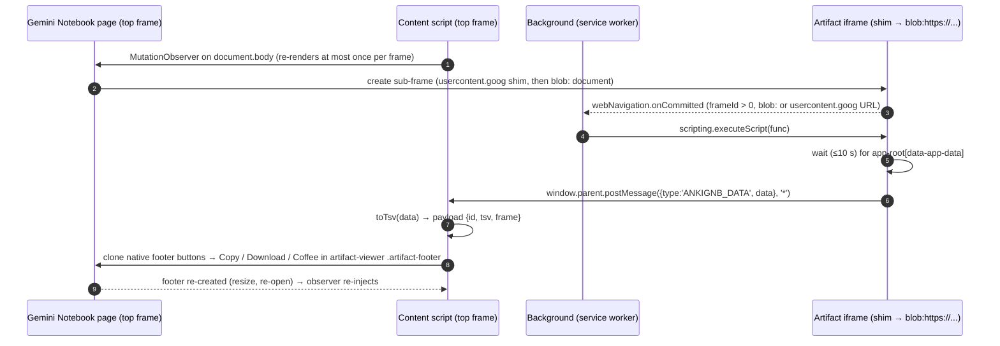

# Architecture

> **Summary:** Three WXT entrypoints work together. The **background** script injects a reader into Gemini Notebook's sandboxed artifact iframe. The reader posts the artifact JSON to the parent frame. The **content** script converts that JSON to TSV and keeps buttons in the artifact footer. The **popup** is static info only.

## Components

| Component | File | Runs in | Responsibility |
|---|---|---|---|
| Background | `src/entrypoints/background/index.ts` | Extension service worker (Chrome) / background page (Firefox) | Detects Gemini Notebook artifact sub-frames and injects the data-reader function into them |
| Content script | `src/entrypoints/content/index.ts` | Every frame of `https://notebook.google.com/*` (and the legacy `notebooklm.google.com`), `allFrames: true`; only the top frame does work | Listens for `ANKIGNB_DATA`, builds the TSV, keeps the buttons in the current artifact footer |
| Popup | `src/entrypoints/popup/*`, `src/components/Popup.tsx` | Toolbar popup | Static help text and links. No logic |
| Utilities | `src/utils/utils.ts`, `src/utils/typeguards.ts` | Bundled into the content script | Footer button factory (clones native buttons), label fitting, JSON → TSV conversion, type guards |
| Types | `src/types.ts` | n/a | Shapes of the Gemini Notebook artifact JSON |
| Manifest config | `wxt.config.ts` | Build time | Per-browser manifest (MV3 for Chrome, MV2 for Firefox) |

## Why an iframe injection?

Gemini Notebook (formerly NotebookLM) Studio renders each generated artifact (flashcards, quiz) in a **sandboxed sub-frame** inside `artifact-viewer .app-frame-container`. Its `src` is `https://<hash>.scf.usercontent.goog/notebooklm-apps/shim.html?origin=https://notebook.google.com` (observed November 2026), and the artifact document is then shown from a `blob:https://` URL on Chrome. Inside that frame, an Angular `<app-root>` element carries the full artifact payload as a JSON string in its `data-app-data` attribute.

Static content scripts can't reliably reach a `blob:` frame, because its origin and URL don't match the manifest `matches`. So the background script watches `webNavigation.onCommitted` and calls `chrome.scripting.executeScript` against that exact `frameId`. The injected function can't call extension APIs or share memory with the content script, so it hands the data over with `window.parent.postMessage`.

> The iframe/blob/usercontent.goog details are **observed**, not from Google documentation. See [Gemini Notebook DOM Contract](gemini-notebook-dom-contract.md).

## End-to-end flow (Chrome)



Ordering doesn't matter: the payload is stored, and the buttons are injected whenever both a payload and a footer exist. When the sending iframe leaves the DOM, the payload is dropped and the buttons are removed.

## Message contract

Sent by the background-injected function (`src/entrypoints/background/index.ts:149`):

```ts
window.parent.postMessage(
  { type: 'ANKIGNB_DATA', data: string /* raw JSON from data-app-data */ },
  '*'
);
```

Received by the content script (`src/entrypoints/content/index.ts:54`):

```ts
window.addEventListener('message', (event) => {
  const message = event.data;
  if (!message || typeof message !== 'object' || message.type !== MESSAGE_TYPE) return;
  // ...toTsv(message.data), store the payload, render()
});
```

- `data` is the **unparsed** JSON string. It's parsed inside `toTsv`.
- The receiver checks the message shape but not its origin (target origin `'*'`, no `event.origin` check). See [Known Issues](known-issues.md#1-postmessage-is-not-origin-checked).

## Repository layout

```
.
├── wxt.config.ts            # Manifest generation per browser
├── package.json             # Scripts & deps
├── tsconfig.json            # Extends .wxt/tsconfig.json (generated)
├── PRIVACY_POLICY.md        # Store-facing privacy statement
├── README.md                # End-user README
├── public/icon/*.png        # 16/32/48/64/96/128 px icons (auto-picked by WXT)
├── docs/                    # ← this wiki
└── src/
    ├── app.config.ts        # Empty
    ├── types.ts             # QuizData, FlashcardData
    ├── components/
    │   └── Popup.tsx        # Popup UI
    ├── utils/
    │   ├── utils.ts         # createStyledButton, fitButtonsToFooter, toTsv, createCsvBlob
    │   └── typeguards.ts    # isQuizData, isFlashcardData
    └── entrypoints/
        ├── background/index.ts
        ├── content/index.ts
        └── popup/
            ├── index.html   # <meta name="manifest.type" content="browser_action">
            ├── main.tsx     # React root
            ├── App.tsx
            ├── App.css      # Mostly leftover starter CSS
            └── style.css    # Real popup styles
```

## Browser split

Both the background and content entrypoints branch on `import.meta.env.FIREFOX` at module level and export a different `define*()` result per browser. The Chrome branch is the working implementation. The Firefox branch is an unfinished prototype. See [Browser Support](browser-support.md).

---

**Related pages:** [Background](modules/background.md) · [Content script](modules/content-script.md) · [Data Formats](data-formats.md) · [Gemini Notebook DOM Contract](gemini-notebook-dom-contract.md)
